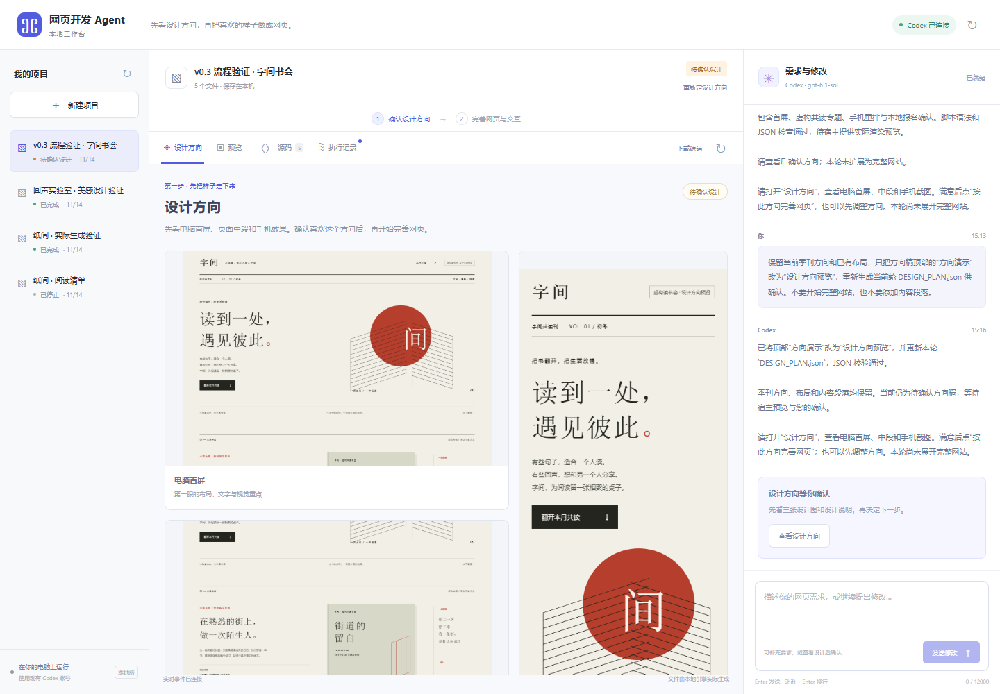
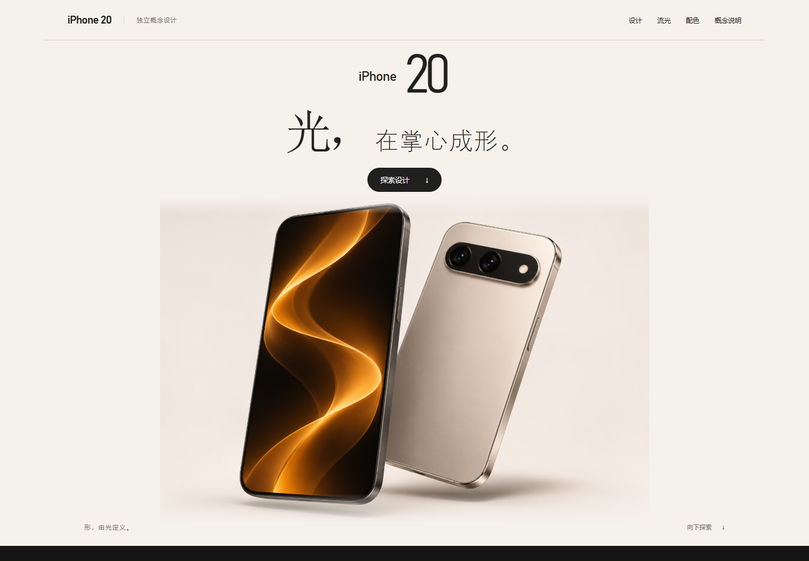

# 网页开发 Agent

**先确认设计方向，再完成网页。** 中文本地工作台，基于已有 Codex 账号执行，适合静态宣传页、作品集和浏览器内的小工具。

当前是 **v0.3 实验版**，需要本机安装并登录 Codex CLI。项目仍在收集真实使用反馈；部分 Windows 执行环境会触发原生命令／文件审批失败或超时，遇到此情况会保留文件并显示未完成，不应理解为已经自动交付成品。

用中文描述需求，先看实际设计方向稿；你确认后，Agent 再完成网页、查看电脑与手机截图并修订。可以继续对话修改，最后下载源码。

当前版本面向 HTML / CSS / JavaScript 静态网站，适合产品介绍页、作品集与浏览器内的小工具。执行来自本机 Codex，界面不返回预先写好的模板冒充生成结果。

v0.3 的变化是把“方向确认”放在完整制作之前。方向稿会写入真实 `index.html`，不是一段描述或预先准备的模板。[查看设计方向确认说明](docs/v0.3-设计方向确认.md)。



## 启动

需要 Node.js 22 或更新版本，以及已安装并登录的 Codex CLI。Windows 推荐保留 Microsoft Edge，用于实际网页渲染检查。

首次使用：在本目录打开终端，运行：

```sh
npm install
npm start
```

使用 pnpm 时，运行 `pnpm install --frozen-lockfile` 和 `pnpm start`；仓库附带 pnpm 锁文件。

打开终端显示的本机地址，通常是 [http://127.0.0.1:4317](http://127.0.0.1:4317)。Windows 也可以双击 `启动网页Agent.cmd`。

如果没有 Edge，先运行 `npx playwright install chromium`。Codex 登录问题可在终端用 `codex login status` 检查，尚未登录时运行 `codex login`。本应用使用 Codex 的正常登录状态，不需要在网页里填写密钥。

## 使用

1. 在右侧输入你要做的网页，也可以先点“新建项目”。建议说清用途、使用者、核心功能、文字内容及风格偏好。
2. 点击“发送需求”，在“执行记录”查看真实进度。执行会使用当前 Codex 账号的额度。
3. 新项目先生成方向稿：桌面首屏、代表性中段和手机布局。在“设计方向”查看实际截图与字体、素材、构图的简要说明。工具页可以只展示一个主要任务区域。
4. 不满意就点击“调整设计方向”并提出修改；满意后点击“按此方向完善网页”，Agent 才扩展完整网页及功能。确认会启动新一轮执行，并使用当前账号额度。方向稿尚不是成品。
5. 完整制作后，Agent 查看实际电脑与手机截图，按七项标准复核并处理最多三项主要问题；改过源码后再次渲染。随后可以提出“保持版式，把主色改成深绿色”“增加搜索功能”等具体修改。
6. 切换“源码”查看文件，点击“下载源码”获取 ZIP。生成项目、对话和每轮证据保存在本应用的 `data/` 目录。

## 留言评价与建议

欢迎在仓库的 **Issues → New issue** 中选择“体验评价”“问题反馈”或“功能建议”。无需修改代码，可以直接描述使用感受、哪里好用、哪里不顺手，并回复其他人的反馈。登录 GitHub 后即可参与；具体功能以仓库已开启的入口为准。

截图和复现步骤最有帮助。不要提交账号密码、API 密钥、登录文件或含个人信息的完整运行日志。想贡献代码可先读 [CONTRIBUTING.md](CONTRIBUTING.md)。喜欢这个项目也可以用 Star 收藏。

旧项目继续做具体修改时直接执行；想整体换风格，点击“重新定设计方向”，先看新方向再确认。已确认项目的局部编辑也不会重新走整套方向确认。重新设计时保留真实内容及有效交互，不因换视觉丢失功能。

任务未完成时会显示失败、已停止或需要处理。缺少浏览器、登录失效、模型报错等情况不会标记为通过。停止后保留已写入的文件；关闭服务后中断的任务不会自动继续。

## 怎样判断设计结果

Agent 在 `DESIGN.md` 说明艺术方向，在 `DESIGN_PLAN.json` 保存待确认的字体、色彩、构图、素材和手机安排。关键素材缺失、预览不全或方向稿变化时，需要处理并重新生成预览，不能直接确认旧稿。

完整制作的七项审查包括用途与表达、信息层级、字体与阅读、色彩与对比、构图与留白、视觉个性、移动端与操作。重点看中文排版、标题和主图的关系、素材质量以及不同章节的节奏。结果保存在 `DESIGN_REVIEW.json`，记录两种视口的具体观察、修改和未解决事项。

运行无错误与设计是否满意分别判断；黑底、大字或 3D 不等于高级。没有数值化美感分数，模型自审通过也不能代替你的风格确认。截图只证明实际观察的范围，自动重渲染不等于又做了一次模型视觉审查。[查看美感设计标准](docs/美感设计标准.md)。

## 当前范围

- 一次执行一个任务；每轮开发最多 7 分钟，随后截图与适用的美感复核另有 3 分钟窗口。沿用本机选定的模型，本应用将推理强度设为中等，并关闭内部子任务编排。
- 支持新建项目和继续修改；暂不支持导入已有仓库、React/Vue 构建项目、后端数据库和自动部署。
- 素材使用本地文件或代码绘制；不新增远程字体、外链素材、CDN、付费图片生成或浏览接口。参考来自用户、宿主、素材库或已提供知识，不声称每轮实时浏览过参考站，也不复制其资产。
- 工作台 API 和预览仅供本机使用，不提供远程协作服务；Codex 执行仍使用当前账号的正常连接与额度。
- 网页预览使用独立的本机端口，与工作台分开。项目脚本可以使用浏览器存储，不能读取工作台，也不能连接外部网络。不要让多个不信任的项目同时保留敏感浏览器数据。
- 自动渲染检查覆盖加载、脚本错误、部分资源与布局问题。截图交给模型审查并不代表独立的设计质量认证，也不替代真实用户的功能验收。
- Codex 的工作目录权限用于限制写入，不能当作完整的系统安全隔离。重要操作按 Codex 的审批请求由使用者决定。

## 项目结构

```text
public/                  中文工作台
server/codex-engine.mjs  Codex app-server 协议、事件与审批
server/orchestrator.mjs  生成、检查、反馈与复查
server/design-plan.mjs   方向计划与素材就绪检查
server/design-guidance.mjs 艺术指导、分阶段实现与审查原则
server/render-check.mjs  浏览器诊断汇总
server/renderer/         实际桌面和手机截图
server/project-store.mjs 项目、对话与运行记录
tests/                   协议、存储、服务与流程检查
data/                    本机项目和证据（不提交 Git）
```

运行 `npm test` 检查协议、并发、路径隔离、失败处理与流程。测试中的替身只用于验证程序逻辑；生产入口始终调用真实 Codex。实际账号执行、网页交互和视觉效果仍需独立验证。

## 示例与验证边界

### iPhone 20 独立概念页



[查看示例源码](examples/iphone20-concept/index.html) · [素材与 AI 图像提示词](examples/iphone20-concept/ASSETS.md)

下载仓库后，可直接双击 `examples/iphone20-concept/index.html` 查看。示例包含材质近景、鼠标／触摸光轨、暖金／石墨配色渐变、手机排版及概念说明弹窗。图片和脚本均在仓库内，无需请求外部素材。

**制作来源：** Agent 生成了方向稿，随后本机 CLI 在文件审批环节中断；宿主 AI 恢复方向稿并接续完成页面、配色图片、过渡和字体修订，再进行浏览器检查。它展示的是一次协作完成的结果，不能当作 Agent 完全自动完成全部流程的证明。页面为非 Apple 官方的独立概念设计，不代表真实产品规格或销售服务。

### 其他流程示例

[字间书会](examples/ziji-reading/index.html)是 v0.3 的虚构读书会样本，实际走过方向稿、调整方向、工作台确认、完整实现、截图审查和修订后渲染。[本版记录](docs/v0.3-设计方向确认.md)说明程序与浏览器检查范围；示例中的报名仅为本地演示。

[纸间阅读清单](examples/paper-reading/index.html)有实际生成、继续修改和浏览器交互的[v0.1 验证记录](docs/验证记录.md)。[回声实验室](examples/echo-lab/index.html)有[v0.2 美感流程记录](docs/v0.2-美感验证.md)及[换方向记录](docs/v0.2.1-沉浸式展览.md)，是没有真实音频或商业背书的虚构概念展示。

不同版本的记录只覆盖所列样本与检查，不能保证所有生成结果的美感或功能。[获奖界面学习](docs/获奖网页界面学习.md)用于提炼设计方法，不是本应用或生成页面的获奖证明。

## 开源

MIT License。提交到 GitHub 时不要包含 `data/`、登录文件、`.env` 或本机日志。当前没有自动发布功能。

源代码按 MIT License 提供。示例图片为 AI 生成的概念素材，来源与提示词见各示例说明；第三方产品名称及商标权利归其权利人，不构成官方关联或背书。
