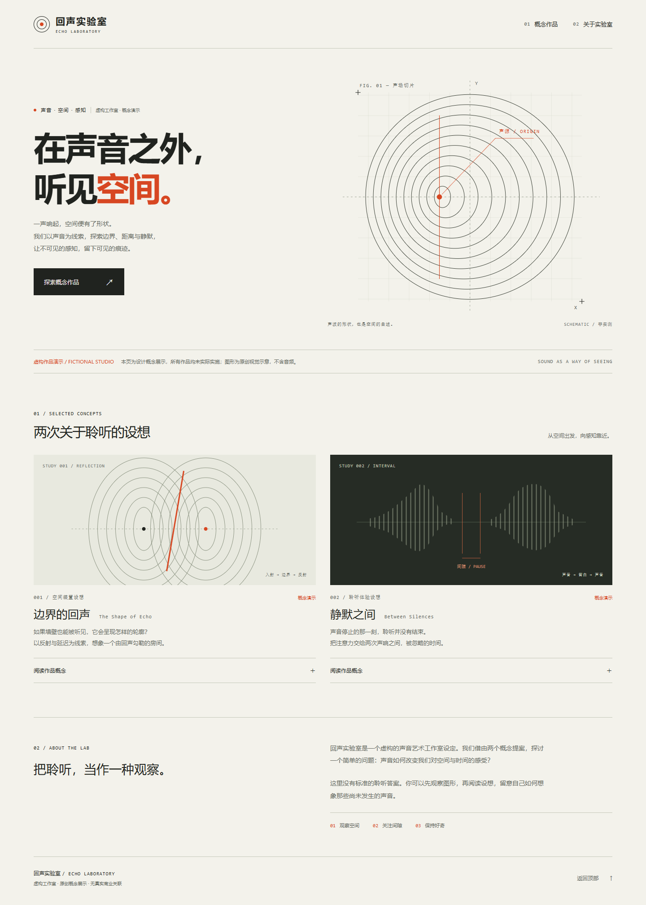

# v0.2 美感设计验证

验证日期：2026-11-14。

## 新增的工作方法

生成阶段加入用途、层级、字体、配色、构图、个性、移动端七项指导；用户给定的风格、品牌与局部修改范围优先。设计方向写入 `DESIGN.md`，并落实为真实网页文件。

第二阶段将实际电脑和手机截图提供给模型，要求每个维度分别记录两端观察、实际修改和未解决问题。`DESIGN_REVIEW.json` 必须绑定本轮编号；缺项、陈旧编号、未检查项目和未解决事项不能被当作已完成的审查。模型判断不代表独立审美认证。

运行检查和设计判断分别记录。证据区分提供给模型的截图版本与最终页面版本；仅更新说明和审查文件不触发重复渲染。网页开发有7分钟上限，截图与美感复核另有3分钟窗口，仍沿用每轮两次模型执行。

## 程序检查

36项检查通过，0失败、0跳过。新增覆盖审查记录与本轮绑定、七项完整性、未解决视觉问题、观察字段、报告大小、元数据更新不重复渲染，以及开发与美感复核使用独立时限。程序检查含测试替身，不用于证明视觉效果。

## 实际案例：回声实验室

需求是一个虚构声音艺术工作室的中文展示页，服务想了解声音与空间关系的访客。没有照片或音频素材，使用原创CSS/SVG、两项明确标注的概念作品、页内导航、作品详情与返回入口。

实际页面采用声场圆环、坐标线、反射椭圆与静默间隙作为图形语言，用暖浅底、深墨文字和信号橙建立信息角色；中文粗无衬线与等宽图注区分主次。此前的纸间阅读清单使用宋体、书页图形与目录排版，两者形成不同的视觉表达。

第一轮审查实际做出三项修订：把虚构演示提示前移至首屏、手机作品区标题与说明改为纵排、增大手机作品正文与详情入口字号。首次整体运行在审查收尾时遇到原7分钟总时限，因此保留中断状态；随后为复核设置独立窗口并在原会话继续。

继续后的真实运行已完成：自动渲染检查无所列问题，七项本轮记录完整且无未解决事项。模型查看最新双端截图后保留网页，只更新说明与审查记录；宿主没有因此重复渲染。最终源码摘要为 `55cfc60a…a674cdd`，完整分轮证据保存在本机项目的 `data/` 内，不随公开源码打包。七项状态是模型的判断。

在1440×1000和390×844中实际点验作品展开/收起、键盘Enter切换、返回作品索引和返回顶部；两端均未发现脚本报错或横向溢出，没有虚假的播放控件。截图以减少动态偏好运行，记录可在本机证据和工作目录的浏览器检查输出中查看。

美感评价仍有主观性。当前案例验证了设计指导、实际文件、截图反馈和具体修订之间的连接，不代表跨行业或大量任务的稳定设计质量评测。
