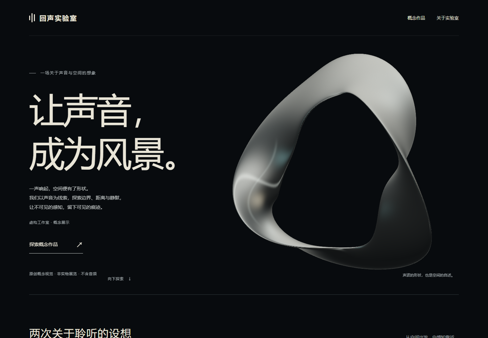

# 回声实验室：沉浸式声音艺术展

用户明确反馈早期米色研究图解风格不够好看，要求更换美感方向。新方案将构图、字体关系、主视觉材料与作品节奏一起重设，保留两项概念作品、详情展开、页内导航和返回功能。

首屏采用近黑空间、暖白大标题“让声音，成为风景。”与大幅缎面金属声波雕塑。雕塑由本地 `sound-sculpture.js` 生成，使用原生WebGL、原创参数化曲面与光照，无外部图像或三维运行库。材质包含宽银色高光、暖反射与少量冰青边缘；不支持WebGL时提供静态Canvas2D表现。

作品区使用两段纵向展陈章节：反射平面表达“边界的回声”，留有间隙的半透明形体表达“静默之间”。主要内容与界面使用中文，虚构概念说明保持可见。

已在桌面与手机中检查立体和静态回退显示；重做后的页面实际点验了两项作品展开/收起、键盘Enter、返回作品索引和返回顶部。1440×1000与390×844未发现脚本报错或横向溢出。减少动态偏好下雕塑保持静态；普通状态动画限制为30fps，并在页面隐藏或离开视口时暂停。

审查记录代表模型的判断，用户的真实反馈优先。当前案例展示一次明确的换方向过程，不保证每个人对视觉效果有相同评价。

