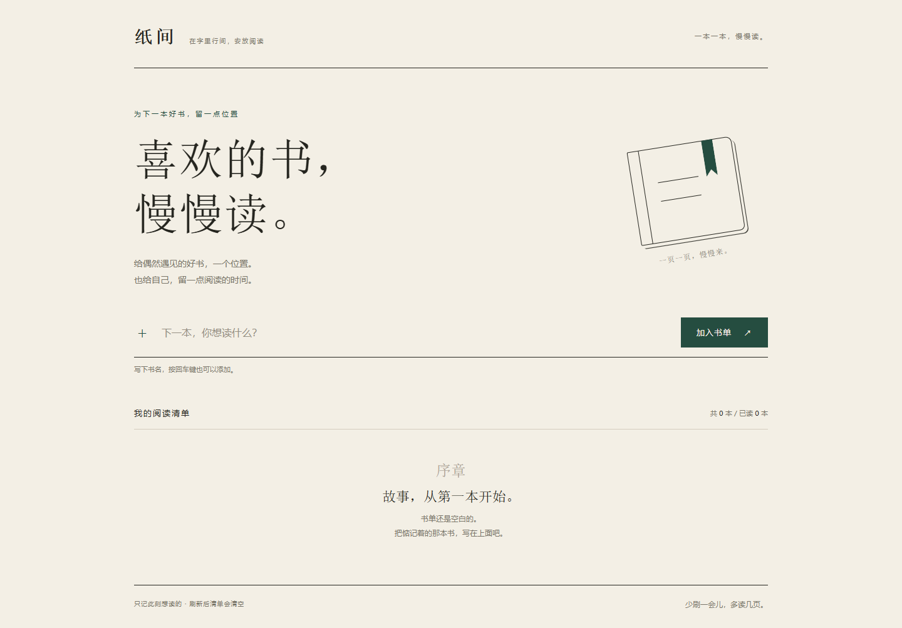

# v0.1.0 验证记录

验证日期：2026-11-14。环境：Windows、Node.js 24.22.1、Codex CLI 0.167.0-alpha.4.1、Playwright 1.62.1 与本机 Microsoft Edge。

## 程序检查

`node --test tests/*.test.mjs`：22 项通过，0 项失败、0 项跳过。覆盖协议分包、真实完成状态判断、会话复用、审批、中断及超时收尾；也覆盖并发提交、路径与 junction 隔离、静态文件服务、独立预览来源、ZIP 和重启恢复。

这些程序检查包含测试替身，不代表真实模型效果。生产入口始终连接本机 Codex。

## 真实执行

使用当前已登录的 Codex 账号和本机选定的 gpt-6.1-sol，没有切换模型或填写新密钥。

1. 从空目录提交中文需求，生成“纸间”阅读清单。Agent 写入 `index.html` 与 `DESIGN.md`；宿主拍摄桌面和手机截图，将截图及诊断传回同一会话；修订后重新渲染。本轮完成约 4 分 50 秒。
2. 在网页工作台中向原项目提交修改需求：砖红改墨绿、标题改为“喜欢的书，慢慢读。”、英文小字改中文，同时处理人为加入的缺失脚本引用。修改前检查确实记录桌面和手机两端的 404；修改后该引用已移除，配色与文字均变化，原有功能保留。第二轮约 2 分 49 秒，两轮使用同一执行会话。

两轮最终报告均无所列自动检查问题，并均向模型提供了实际截图进行审查。第一轮源码摘要为 `14371969…f847a5`；修改后为 `f6a8285c…77a36`。完整运行与截图证据保存在本机项目 `data/` 中，不随源码包发布。

此前一次使用本机原先的高强度推理和子任务设置的尝试超时，未宣称成功。随后将应用执行强度设为中等、关闭内部子任务编排，再完成上述验证。运行中也实际遇到过连接重试；上述耗时是本次记录。

## 浏览器操作

在 1440×1000 桌面和 390×844 手机视口中实际操作并通过：新增书名、切换已读、删除、空状态、空输入提示，以及输入包含 HTML 字符时按文字呈现。两端均未发现脚本报错或横向溢出。

在工作台的真实 iframe 内确认浏览器存储可用，生成页面无法读取父工作台的文档。工作台的新建对话框、预览/源码/记录切换、移动端区域切换，以及发送后续修改需求均已操作。

自动检查没有证明所有可能输入、无障碍规范或所有浏览器兼容性；视觉审查也不是独立设计评分。当前验证针对静态网页流程。
